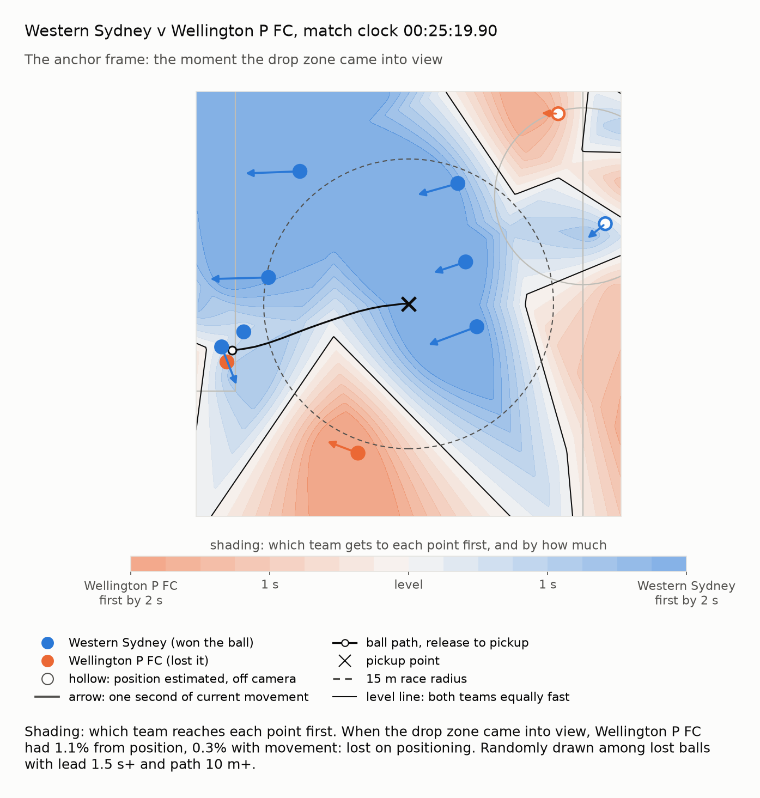
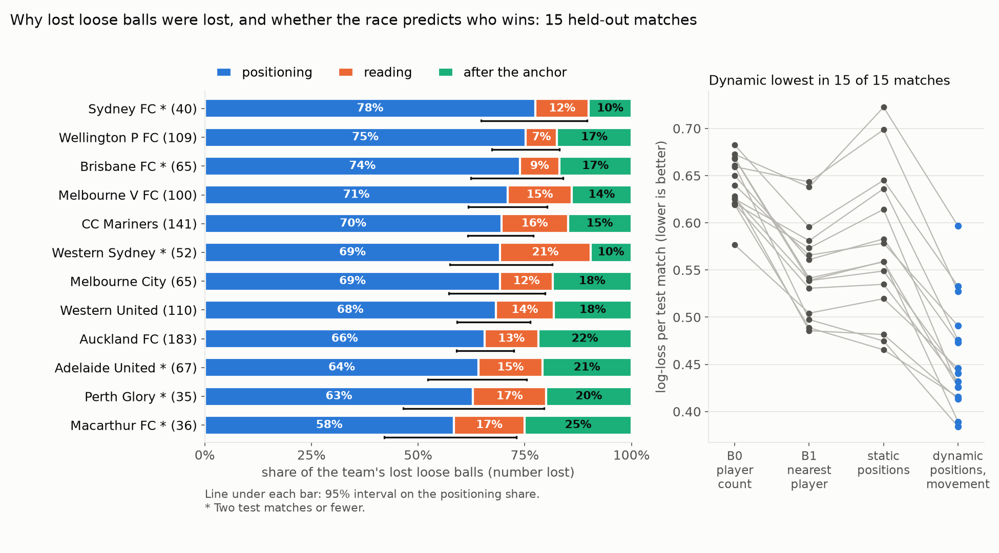

# Loose Balls: Second to the ball

## 1. The answer

When a team loses a loose ball, was it lost on where its players stood, on where they were moving, or in the race itself? This entry reads 20 A-League 2024/25 broadcast-tracking matches from SkillCorner: 5 to build the method, 15 held out. On the 15 held-out matches, 69.0% of lost loose balls were already lost on positioning by the time the drop zone came into view, 13.5% on reading, and 17.6% in the race itself. The package looseball finds each loose ball, reads each loss and exports clips by verdict.

## 2. What a loose ball is here

A loose ball is a release after which nobody controls the ball directly: after a clearance, failed pass, shot, dispossession, non-pass header, unclear end, or a completed pass the receiver did not control. The held-out matches hold 1,566 with the drop zone seen, about 104 a match. Clean receptions and interceptions are excluded, since someone controlled the ball at once, as are held saves, restarts and stoppages. Contests decided within half a second of the drop zone coming into view (10.3%) are counted, not read.

## 3. How a lost ball is read

The camera follows the ball: at release the drop zone was off screen in 35.2% of episodes in the build matches, and only 33.0% of the players near it were seen rather than estimated. Each loose ball is therefore read at its anchor, the first frame after the last touch with the drop zone in view.

Each player's time to the pickup point comes from DataBallPy's time-to-intercept model (0.7 s reaction, 5 m/s top speed). The static expectation is a team's chance of winning from where its players stand at the anchor. The dynamic expectation adds their current velocity. The actual outcome is who controlled the ball. A positioning loss means the team was not favourite from where it stood; reading, that it was but its movement gave the advantage away; after the anchor, that it was still favourite with movement and lost the race. The verdicts depend on no fitted parameter.



## 4. What held

All checks were fixed in advance and run once. The dynamic expectation's log-loss was 28.4% lower than a count of each team's players near the drop zone and 17.0% lower than each team's nearest player, in all 15 matches, with 95% intervals clear of zero. It was 17.2% lower than the static expectation given its own temperature, in all 15; that static line was no better than the nearest player (lower in 4 of 15). Under six changes made one at a time, from an anchor 0.2 s later to a 0.35 s reaction, 91.1% to 99.7% of verdicts stayed the same. The camera gate, which needs 85% of players within 15 m seen, dropped 27.7% of balls against a 30% limit (28.2% when the releasing team won, 27.4% when it lost). Without it, the 1,404 lost balls split 69.5%, 12.6% and 17.9%. Second balls have been studied with event data ([Sunjic et al. 2025](https://www.tandfonline.com/doi/full/10.1080/24748668.2025.2462399); [Lamberts 2025](https://marclamberts.medium.com/introducing-expected-second-ball-retention-adding-value-to-second-balls-1988aa309d9f)); a tracking-based decomposition of why a loose ball was lost is new.



## 5. For the coaching staff

`looseball run` writes a clip table per match: match id, period, clock, anchor frame, losing team and verdict for each lost ball, so an analyst can cue each clip at the anchor and watch one verdict at a time. The worked match, Western Sydney against Wellington P FC, has 61 lost balls: 46 positioning, 6 reading, 9 after the anchor. A coach might read positioning as shape, reading as scanning and the first step, and after the anchor as duels; the tool sorts the clips and does not test those fixes. `clips_enough.csv` adds how much closer the best-placed player needed to start for the model to call the race level: a median 2.5 m over 557 positioning losses with a player to move and 1.1 m for reading losses. In 85 positioning losses the team had no player within 15 m. `looseball animate` draws any lost ball as moving dots.

## 6. Limitations

Positioning means positioning when the drop zone came into view, not shape before the kick. The camera gate drops 55.7% of clearances; 30 remain. Velocity enters the reach model only as drift during the 0.7 s reaction. The expectation is slightly under-confident: balls rated 29.9% for the releasing team were won 18.8% of the time. Reach times run to the pickup point, where the winner took the ball; on ground balls with a path favourite, 11.8% of positioning losses (25 of 211) had the loser reaching the ball's path first. Thirty-one after-the-anchor verdicts are ties with no player of either team within 15 m, and 50 positioning losses had the loser favourite once movement counted. Under a turning penalty the same change and player hold in 63.7% of balls, and the distance has a rank correlation of 0.66. Results are team level only, from 1 to 5 held-out matches per team, in one league.

## 7. Reproduce and reuse

With Python 3.12, [uv](https://docs.astral.sh/uv/) and [Git LFS](https://git-lfs.com):

```
git clone https://github.com/amin8448/loose-balls && cd loose-balls && uv sync
git lfs install
git clone https://github.com/SkillCorner/opendata data/opendata
git -C data/opendata checkout 4340d27
uv run looseball reproduce --data data/opendata --out results
```

This regenerates the main-test tables and both figures in about 6 minutes (peak memory 0.9 GB), and `uv run python scripts/check_reproduce.py results` compares them with the committed record. Outside `looseball/adapters` the code reads provider-neutral tables in DataBallPy's layout, so another provider needs one adapter, and a DataBallPy contribution would add the episode finder and race expectation next to its time-to-intercept model. What players should have done tactically needs the coach's game model ([Shah 2026](https://amarshah.dev/blog/simulated-annealing-positional-optimization/); [Le et al. 2017](https://www.sloansportsconference.com/research-papers/data-driven-ghosting-using-deep-imitation-learning)) and is not attempted. Record: DESIGN.md, AUDIT.md. Licence: MIT.

Data from SkillCorner and PySport; reach model from DataBallPy.
